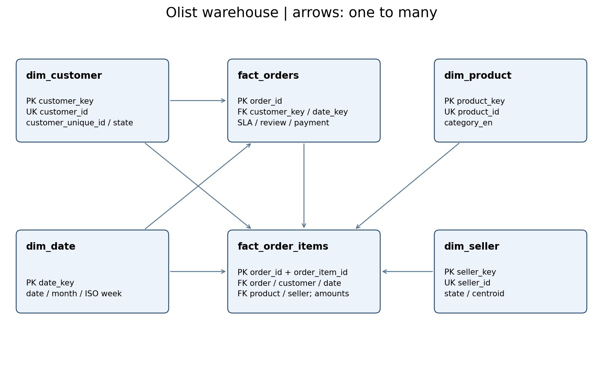

# Star schema

Arrows are one-to-many. Customer dimension preserves customer_id address snapshots; group customer_unique_id for retention. Facts have FK constraints and indexes. Seller/category groups overlap; aggregate items before joining payments. See data_dictionary.md and business_rules.md.
